<!--
  ╭────────────────────────────────────────────╮
  │                                            │
  │             ABHA'S LITTLE WORLD            │
  │                                            │
  │       built with curiosity & chaos ♡       │
  │                                            │
  ╰────────────────────────────────────────────╯
-->

<!-- ═══════════════ HERO ═══════════════ -->

<div align="center">


<a href="https://git.io/typing-svg">
  
</a>

**somewhere between creative chaos and clean code.**

<a href="https://www.linkedin.com/in/abha-mam/">
  
</a>


<sub><b>
<a href="#-a-little-bit-about-me">PLAYER</a> ✧
<a href="#-main-quests">QUESTS</a> ✧
<a href="#-the-tech-behind-the-chaos">INVENTORY</a> ✧
<a href="#-github-after-hours">STATS</a> ✧
<a href="#-achievements-unlocked">TROPHIES</a> ✧
<a href="#-a-tiny-easter-egg">???</a>
</b></sub>

</div>

<!-- ═══════════════ ABOUT ═══════════════ -->


### ✦ a little bit about me


I like creating things that feel a little different.

Sometimes that's a full-stack application. Sometimes it's a multiplayer game. Sometimes it's an unnecessarily elaborate interactive interface because apparently a normal button wasn't interesting enough.

I enjoy everything from low-level systems to creative web development, and I'm always looking for an excuse to learn something new.

<details>
<summary><b>inspect player</b></summary>

```javascript
const abha = {
  location: "somewhere in the codebase",
  education: "B.S. Computer Science @ Penn State",

  loves: [
    "making interactive things",
    "full-stack development",
    "game development",
    "understanding how stuff works",
    "building something from nothing"
  ],

  currently: {
    building: "whatever idea i got attached to this week",
    learning: "better system design & algorithms",
    exploring: "open source and creative coding",
    debugging: "probably everything"
  },

  browserTabs: Infinity,

  philosophy: "why just imagine it when you can build it?"
};
```

</details>

<!-- ═══════════════ MAIN QUESTS ═══════════════ -->


### ✦ main quests

*the things that actually made it out of the idea stage.*

<div align="center">

<a href="https://github.com/xxangelmamxx/Mini-Shell-Project"></a>
<a href="https://github.com/xxangelmamxx/3D-Transformations-and-Heightmap-Based-Terrain-Rendering"></a>
<a href="https://github.com/sanjaysaini383/observability-platform/pull/34"></a>
<a href="https://github.com/xxangelmamxx/BobaLab"></a>
<a href="https://github.com/xxangelmamxx/Adulting-101"></a>
<a href="https://valorant-agent-lineups.vercel.app"></a>

</div>

<!-- ═══════════════ TECH STACK ═══════════════ -->


### ✦ the tech behind the chaos

*things i've learned, used, broken, fixed, and occasionally fought with.*

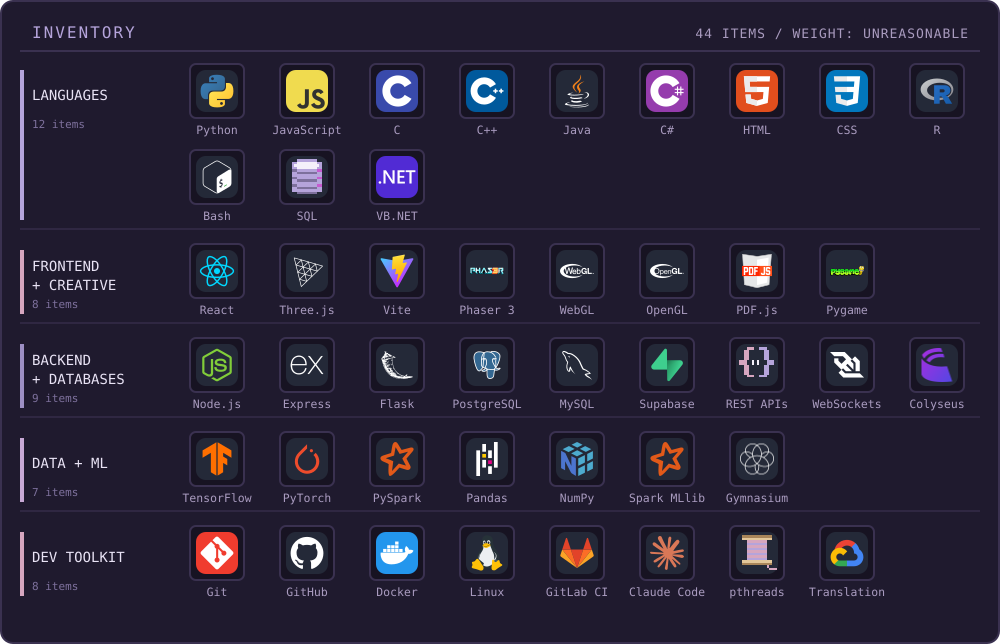

<details>
<summary><b>view as plain text</b></summary>

| shelf | items |
|:--|:--|
| **languages** | Python, JavaScript, C, C++, Java, C#, HTML, CSS, R, Bash, SQL, VB.NET |
| **frontend & creative** | React, Three.js, Vite, Phaser 3, WebGL, OpenGL, PDF.js, Pygame |
| **backend & databases** | Node.js, Express, Flask, PostgreSQL, MySQL, Supabase, REST APIs, WebSockets, Colyseus |
| **data & machine learning** | TensorFlow, PyTorch, PySpark, Pandas, NumPy, Spark MLlib, Gymnasium |
| **developer toolkit** | Git, GitHub, Docker, Linux, GitLab CI, Claude Code, POSIX Threads, Google Cloud Translation API |

</details>

<!-- ═══════════════ SIDE QUESTS ═══════════════ -->


### ✦ current side quests


<!-- ═══════════════ GITHUB ACTIVITY ═══════════════ -->


### ✦ github after hours

*some evidence that i do, in fact, write code.*

<div align="center">


<!-- Generated daily by .github/workflows/snake.yml -->

<picture>
  <source media="(prefers-color-scheme: dark)" srcset="https://raw.githubusercontent.com/xxangelmamxx/xxangelmamxx/output/snake-dark.svg" />
  <source media="(prefers-color-scheme: light)" srcset="https://raw.githubusercontent.com/xxangelmamxx/xxangelmamxx/output/snake-light.svg" />
  
</picture>

</div>

<!-- ═══════════════ ACHIEVEMENTS ═══════════════ -->


### ✦ achievements unlocked

*collecting knowledge like it's an RPG inventory.*

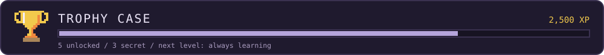

<a href="https://github.com/sanjaysaini383/observability-platform/pull/34">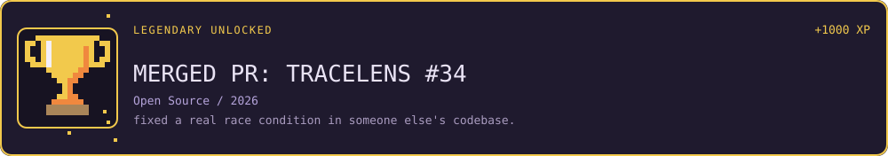</a>

<div align="center">

<a href="https://drive.google.com/file/d/1tEYbA8svLlamGG0tpbyJLTiKHR8q2Qwd/view">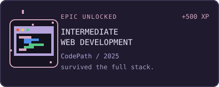</a>
<a href="https://www.credly.com/badges/ed31293c-cb3d-4457-ba95-e4074dfd071d/print">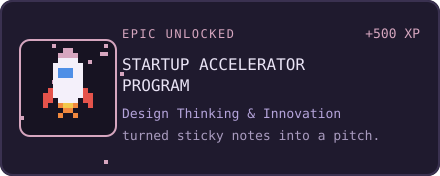</a>
<a href="https://www.coursera.org/account/accomplishments/verify/ESVDZ4MFJBY5">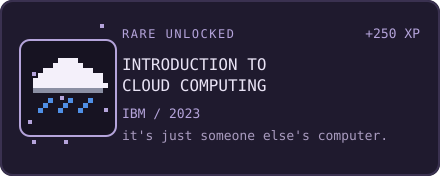</a>
<a href="https://drive.google.com/file/d/14RUpj3geWj6El6QFFofZ9rFuX7JPhjfT/view">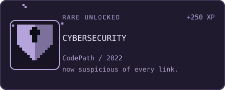</a>

</div>

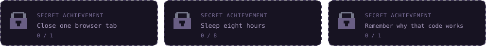

<!-- ═══════════════ EASTER EGG ═══════════════ -->


### ✦ a tiny easter egg

<details>
<summary>psst... click here ✧</summary>

```text
   /\_/\
  ( o.o )
   > ^ <

  you found the secret cat.

  +10 curiosity
  +5 developer XP
  +1 browser tab (probably)
```

congratulations, you are now legally obligated to have a good day ♡

<details>
<summary>the cat is holding something...</summary>

```text
  ★ RARE DROP: one (1) closed browser tab

  just kidding. it reopened itself.
```

</details>

</details>

<!-- ═══════════════ FOOTER ═══════════════ -->

<br/>

<div align="center">


### thanks for visiting my little corner of the internet.

*feel free to explore, say hi, or judge my commit history.*

**made with ♡, curiosity, and an unreasonable number of open tabs.**

<sub>the code works. why? excellent question.</sub>

</div>
